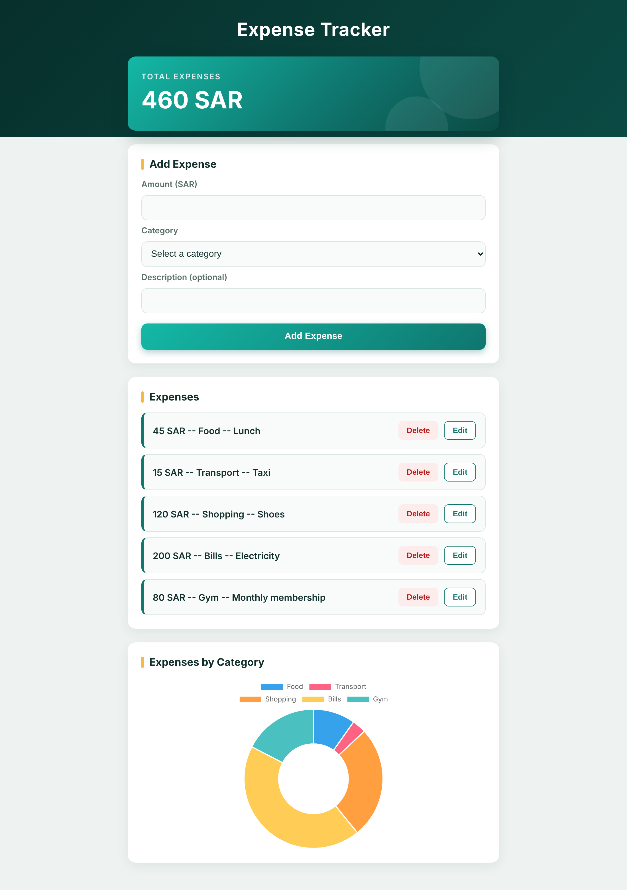
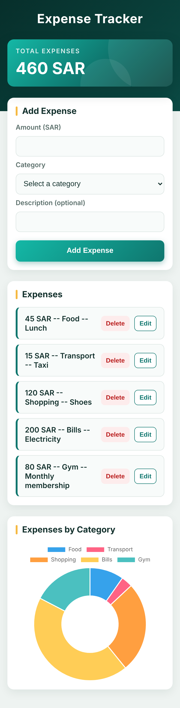
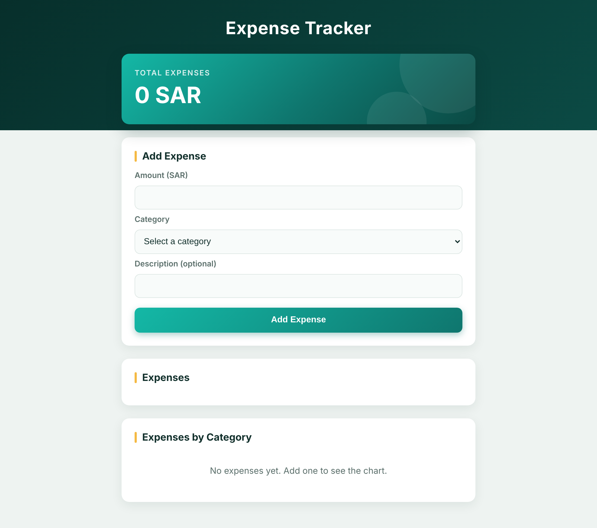
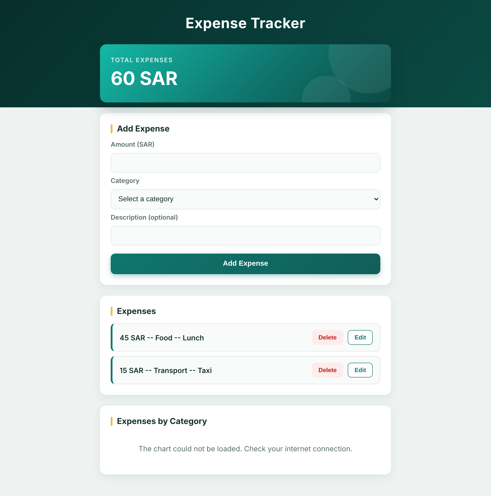
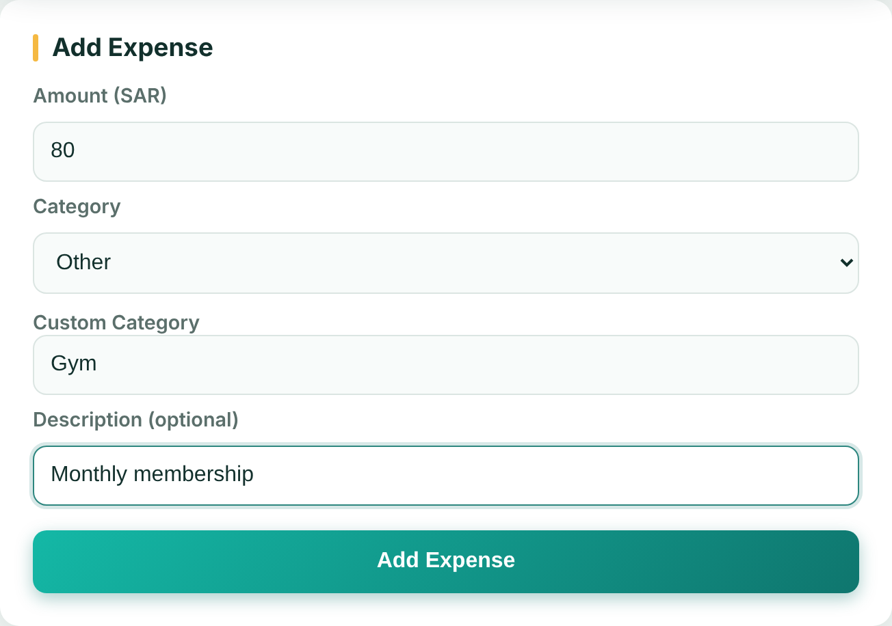
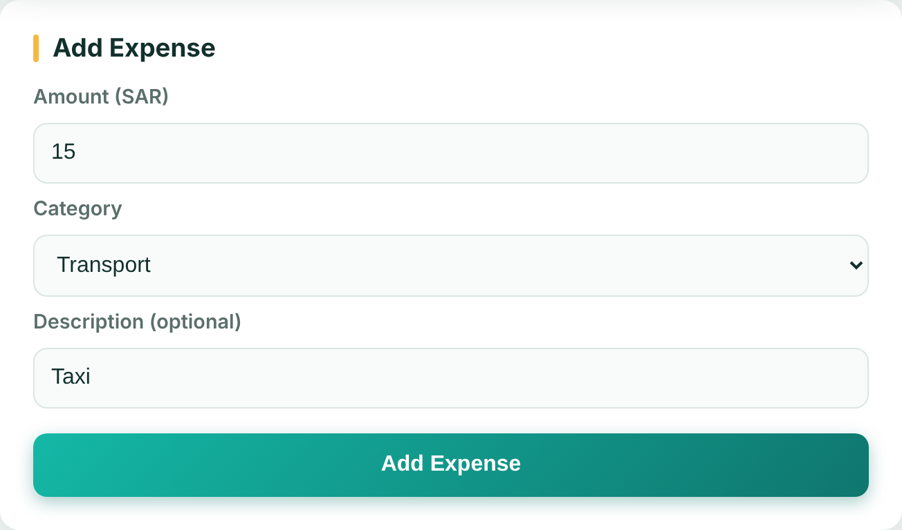

# Expense Tracker

A responsive expense tracking web app built with **vanilla JavaScript**. Add, edit and delete expenses, watch the running total update, and see where your money goes in a donut chart grouped by category.

**Live demo:** https://Mo7ammedaga.github.io/expense-tracker/



<p align="center">
  
</p>

## Features

- **Add expenses** with an amount, a category and an optional description.
- **Built-in categories** (Food, Transport, Shopping, Bills) plus **custom categories** through the "Other" option.
- **Name normalization** for custom categories: `food`, `FOOD` and `fOOD` are all stored as `Food`, so they group together with the built-in category.
- **Edit in place**: the form is filled with the selected expense and saving replaces it (the expense keeps its `id`).
- **Delete** any expense. Deleting the expense that is currently being edited safely leaves edit mode.
- **Live total** of all expenses.
- **Donut chart** (Chart.js) of spending by category, redrawn after every add, edit and delete.
- **Friendly chart messages**: "No expenses yet" when the list is empty, and a clear message if the chart library could not be loaded (for example, no internet).
- **Form validation** in JavaScript (the form uses `novalidate`, so the app shows its own alerts instead of the browser's): amount must be positive, a category is required, and a custom category name is required when "Other" is selected.
- **Responsive layout** that works on phones and desktops.

## Screenshots

| Empty state                                                                    | Chart library not loaded                                                          |
| ------------------------------------------------------------------------------ | --------------------------------------------------------------------------------- |
|  |  |

| Custom category ("Other")                                                             | Edit mode (form filled with the expense)                            |
| ------------------------------------------------------------------------------------- | ------------------------------------------------------------------- |
|  |  |

## Tech stack

| Area      | Tools                                                                      |
| --------- | -------------------------------------------------------------------------- |
| Structure | HTML5 (semantic sections, labelled form fields)                            |
| Styling   | CSS3: custom properties (design tokens), Flexbox, gradients, media queries |
| Logic     | Vanilla JavaScript (ES6+), no framework                                    |
| Charts    | [Chart.js](https://www.chartjs.org/) 4.4.1, loaded from a CDN              |

## Getting started

There is no build step and no dependencies to install.

```bash
git clone https://github.com/Mo7ammedaga/expense-tracker.git
cd expense-tracker
```

Then open `index.html` in your browser (or use the VS Code **Live Server** extension).

> The chart library is loaded from a CDN. Without an internet connection the app still works (add, edit, delete, total) and shows a message instead of the donut chart.

## Project structure

```
expense-tracker/
├── index.html        # Page structure: total, form, expenses list, chart
├── style.css         # Design tokens (CSS variables), layout, responsive rules
├── script.js         # All the logic, organized in numbered sections
└── screenshots/      # Images used in this README
```

## How it works

The `expenses` Array is the **single source of truth**. The page is only a picture of it, and every user action follows the same flow:

```
User action  ->  update the expenses Array  ->  renderExpenses()
                                                  ├─ redraws the list
                                                  ├─ recalculates the total
                                                  └─ redraws the donut chart
```

Because there is one `renderExpenses()` that redraws everything from the Array, Add, Edit and Delete never repeat UI code, and the list, the total and the chart can never disagree with each other.

### Main functions

| Function              | Responsibility                                                                                                                                          |
| --------------------- | ------------------------------------------------------------------------------------------------------------------------------------------------------- |
| `renderExpenses()`    | Clears and rebuilds the list from the Array, updates the total, then calls `renderChart()`.                                                             |
| `calculateTotal()`    | Reducer used by `reduce()` to sum the amounts.                                                                                                          |
| `getCategoryTotals()` | Groups the expenses by category and returns an Object like `{ Food: 50, Transport: 15 }`.                                                               |
| `renderChart()`       | Destroys the previous Chart.js instance, then either draws a new donut from the category totals or shows a message (no expenses / Chart.js not loaded). |

`renderChart()` also runs **once when the page opens**, so the "No expenses yet" message is visible from the start.

### Edit mode

A single variable, `editingExpenseId`, decides what the form does on submit:

- `null`: the form **adds** a new expense (`push`).
- a number: the form **replaces** the expense with that `id` (`findIndex` + assignment).

It goes back to `null` when the edit is saved, or when the expense being edited is deleted.

## Concepts practiced

- DOM selection and manipulation (`querySelector`, `createElement`, `append`, `textContent`, `dataset`)
- Events (`submit`, `change`, `click`) and `preventDefault`
- Array methods: `push`, `forEach`, `filter`, `reduce`, `findIndex`, `includes`
- Objects as data records, and as a lookup table for grouping
- Early return for validation
- Keeping state in one place and rendering from it
- Responsive CSS with custom properties

## Known limitations

- **Data is kept in memory only.** Refreshing the page clears the expenses (persistence was intentionally out of scope for this version).
- Amounts are plain JavaScript numbers, so totals are not formatted to two decimals and can show floating-point artifacts (for example `0.1 + 0.2`).
- A custom category made only of spaces is not rejected.
- There is no "Cancel" button for edit mode.

## Ideas for next steps

- Persist the expenses with `localStorage`.
- Format amounts to two decimals.
- Trim whitespace in text inputs.
- Add a cancel button for edit mode.
- Filter expenses by date.

## Author

**Mohammed Alagha**: [GitHub](https://github.com/Mo7ammedaga)
